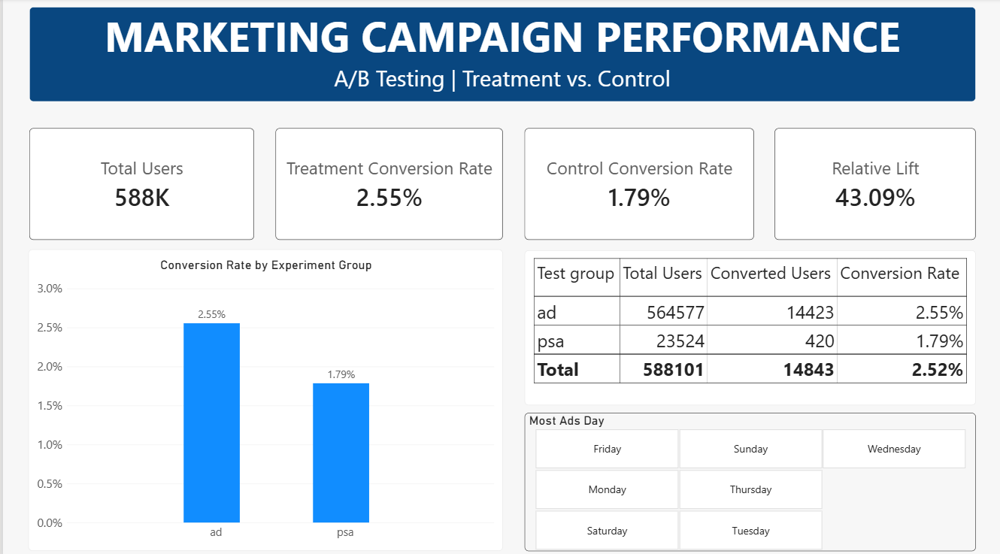
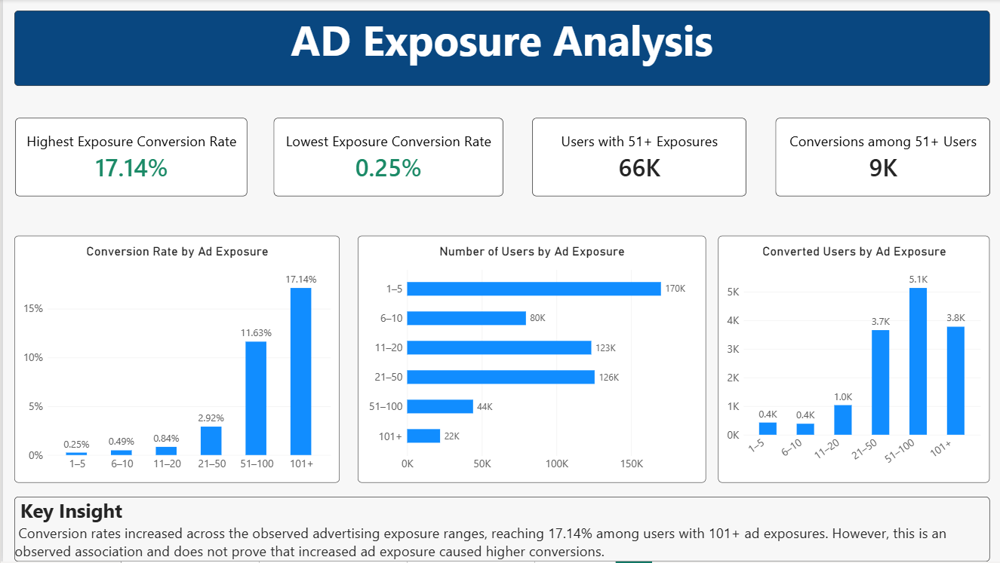
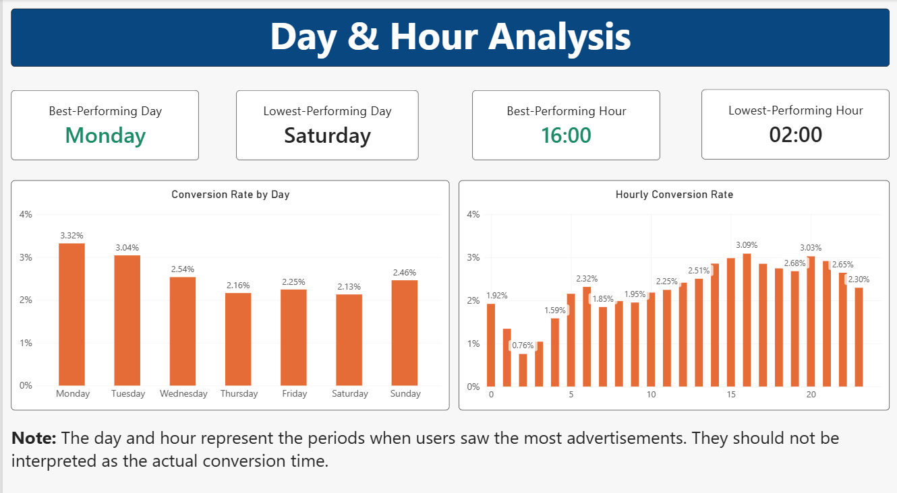
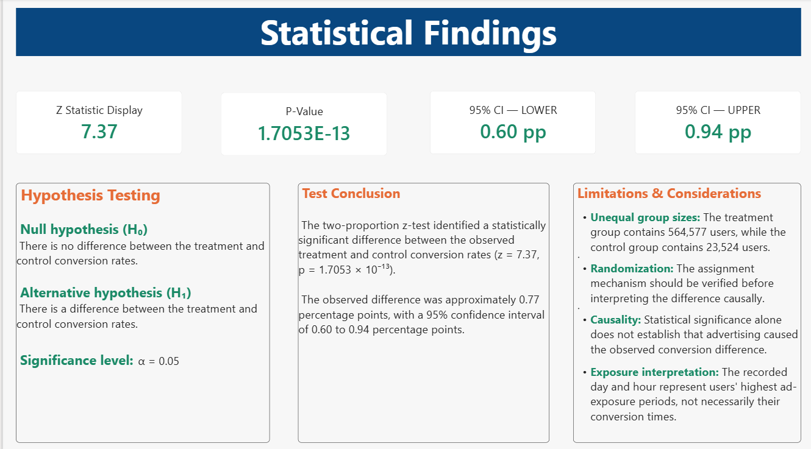

# Marketing Campaign A/B Testing & Conversion Analysis

## Project Overview

An end-to-end marketing campaign analytics project evaluating advertising performance by comparing a treatment group exposed to advertisements with a control group exposed to public service announcements (PSAs).

The project uses Excel for data validation and descriptive analysis, statistical hypothesis testing to evaluate conversion-rate differences, and Power BI to present campaign performance through an interactive dashboard.

## Business Objectives

- Compare conversion rates between treatment and control groups.
- Evaluate whether the observed conversion-rate difference is statistically significant.
- Examine conversion behaviour across advertising exposure frequencies.
- Identify variations in conversion rates across days and hours.
- Present campaign findings through an interactive Power BI dashboard.

## Dataset

- **Source:** [Marketing A/B Testing — Kaggle](https://www.kaggle.com/datasets/faviovaz/marketing-ab-testing)
- **Records:** 588,101
- **Columns:** 6
- **Treatment group:** ad
- **Control group:** psa

## Tools & Techniques

- **Excel:** Data quality validation, formulas, conversion analysis and descriptive exploration.
- **Statistics:** Two-proportion z-test, p-value, confidence intervals, absolute conversion difference and relative lift.
- **Power BI:** Interactive KPI cards, conversion comparisons, exposure analysis, day/hour trends and statistical findings.

## Data Quality Validation

| Validation | Result |
|---|---:|
| Total records | 588,101 |
| Unique users | 588,101 |
| Duplicate user IDs | 0 |
| Missing values | 0 |
| Invalid conversion values | 0 |
| Invalid ad exposure values | 0 |

## Overall Conversion Analysis

| Metric | Treatment (ad) | Control (psa) |
|---|---:|---:|
| Total users | 564,577 | 23,524 |
| Converted users | 14,423 | 420 |
| Conversion rate | 2.55% | 1.79% |

- Absolute conversion-rate difference: **0.77 percentage points**
- Relative conversion-rate difference: **43.09%**

## Statistical Hypothesis Testing

A two-tailed two-proportion z-test was conducted at a 5% significance level.

- Null hypothesis: Treatment and control conversion rates are equal.
- Alternative hypothesis: Treatment and control conversion rates differ.
- Z-statistic: **7.37**
- P-value: **1.7053 × 10⁻¹³**
- 95% confidence interval for the difference: **approximately 0.60 to 0.94 percentage points**

The observed conversion-rate difference was statistically significant.

## Ad Exposure Analysis

| Ad exposure range | Conversion rate |
|---|---:|
| 1–5 | 0.25% |
| 6–10 | 0.49% |
| 11–20 | 0.84% |
| 21–50 | 2.92% |
| 51–100 | 11.63% |
| 101+ | 17.14% |

Conversion rates increased across the observed exposure bands. This is an association and does not establish a causal effect of increased advertising exposure.

## Day and Hour Analysis

- Highest day-wise conversion rate: Monday (3.32%).
- Lowest day-wise conversion rate: Saturday (2.13%).
- Highest hour-wise conversion rate: 16:00 (3.09%).
- Lowest hour-wise conversion rate: 02:00 (0.76%).

The day and hour fields represent when users saw the most advertisements, not necessarily when conversions occurred.

## Power BI Dashboard

The interactive report contains four analytical pages:

1. **Campaign Overview:** Total users, treatment and control conversion rates, relative lift and group comparison.
2. **Ad Exposure Analysis:** Conversion rates and user distribution across six advertising exposure ranges.
3. **Day & Hour Analysis:** Conversion-rate variations by day of the week and hour.
4. **Statistical Findings:** Hypothesis test results, confidence interval and analytical limitations.

### Dashboard Screenshots

#### 1. Campaign Overview

#### 2. Ad Exposure Analysis

#### 3. Day & Hour Analysis

#### 4. Statistical Findings

## Key Findings

- The treatment group recorded a higher observed conversion rate than the control group.
- The difference was statistically significant under the two-proportion z-test.
- Higher advertising exposure bands had higher observed conversion rates.
- Conversion rates varied across days and hours.
- The findings identify patterns for further campaign investigation rather than proving advertising exposure caused conversions.

## Limitations

- The treatment and control groups have substantially different sample sizes.
- The experiment assignment and randomization process require verification.
- The observed association between exposure frequency and conversion does not establish causality.
- The dataset does not identify the exact time of conversion.

## Project Structure

- `Excel/` — Excel workbook and analysis.
- `PowerBI/` — Power BI report.
- `Screenshots/` — Dashboard screenshots.
- `Documentation/` — Methodology and supporting documentation.

## Conclusion

This project demonstrates the application of data validation, conversion analysis, statistical hypothesis testing and interactive business intelligence reporting to evaluate marketing campaign performance.
